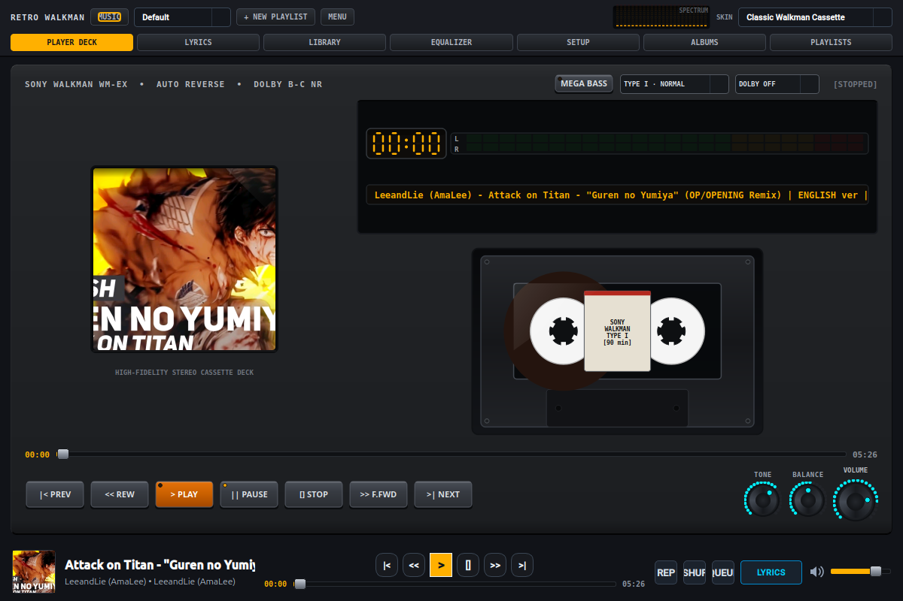
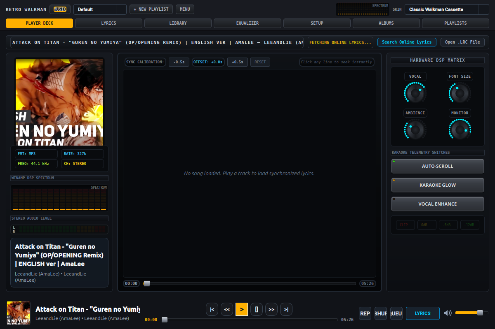
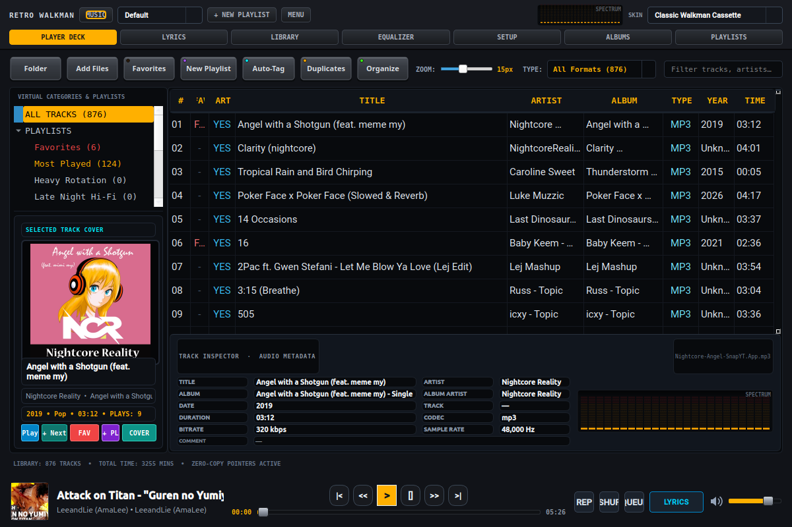
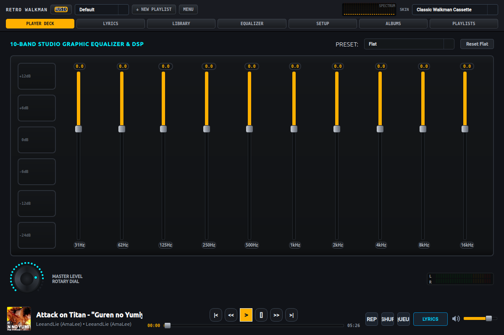
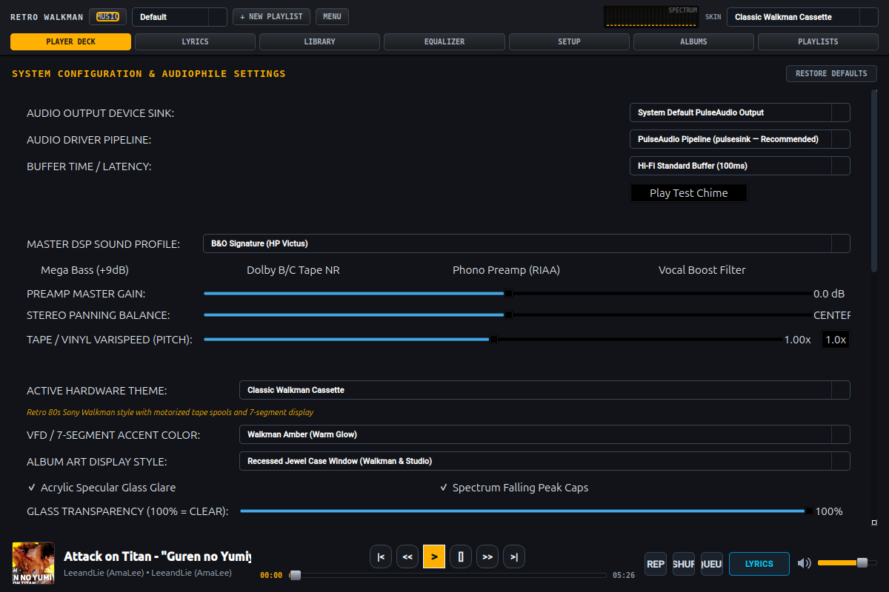
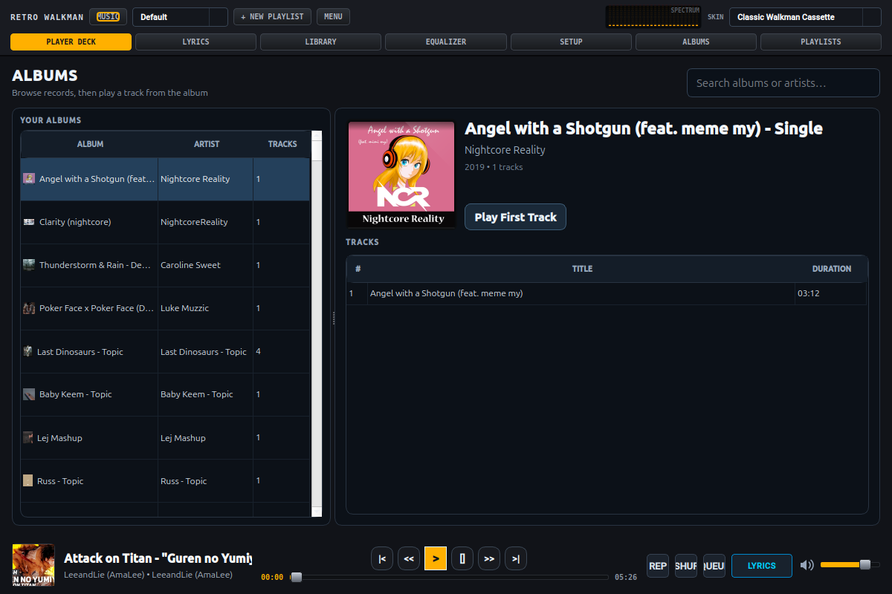
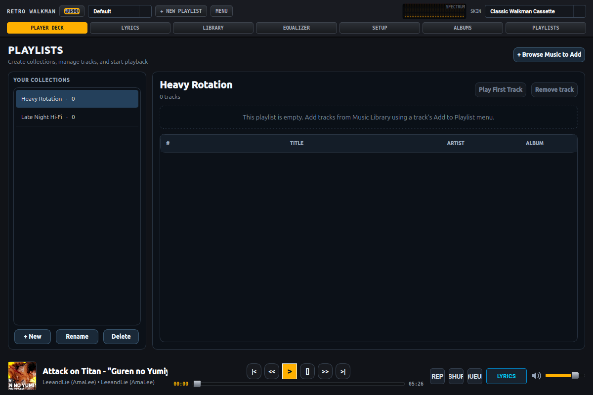

# 🎧 Retro Walkman — Desktop (Linux)

A vintage-styled desktop music player built with Python and PyQt5. Features a cassette deck UI, vinyl turntable widget, VU meters, spectrum analyzer, and a full-featured music library — all wrapped in a nostalgic retro aesthetic.

---

## ✨ Features

### 🎛️ Player Deck
- **Cassette deck** with animated tape reels and vintage controls
- **Vinyl turntable widget** with spinning record and tonearm
- **Click wheel** navigation inspired by classic portable players
- **Hero cover art** display with album artwork
- **Rotary knob** volume control

### 📊 Audio Visualizations
- **Analog VU meters** — dual-needle meters responding to audio levels
- **Spectrum analyzer** — real-time FFT frequency display
- **Waveform visualizer** — scrolling waveform of the current track
- **7-segment display** — retro LED-style track info readout

### 🎵 Music Library
- Browse by **Songs**, **Albums**, **Artists**, **Playlists**
- Folder/directory browsing
- **Batch metadata enrichment** — auto-fetch and fill missing tags
- **Duplicate track detection & resolver**
- **Library organizer** — rename and sort files by metadata
- **Manual cover art** assignment

### 📝 Lyrics
- Auto-fetch lyrics from online sources
- Manual lyrics editor
- Scrolling lyrics display synced to playback

### 🎚️ Equalizer
- Multi-band equalizer with presets
- Real-time adjustments

### 🔧 Additional Features
- **Queue drawer** with drag-and-drop reordering
- **Metadata editor** — edit tags directly in the app
- **Track details** dialog
- **MPRIS D-Bus integration** — works with Linux media keys and desktop controls
- **System notifications** for now-playing
- **Persistent state** — remembers queue, position, and settings across restarts
- **Boot splash screen** with retro animation
- **Desktop entry** for app launcher integration

---

## 📸 Screenshots

| Player Deck | Library | Albums |
|-------------|---------|--------|
|  |  |  |

| Playlists | Lyrics | Equalizer |
|-----------|--------|-----------|
|  |  |  |

| Settings |
|----------|
|  |

---

## 🛠️ Installation

### Prerequisites
- Python 3.8+
- PyQt5

### Install Dependencies
```bash
pip install PyQt5
```

### Run
```bash
python3 retro_walkman.py
```

### Desktop Integration (Linux)
```bash
# Copy the desktop entry (edit paths if needed)
cp retro-walkman.desktop ~/.local/share/applications/

# Make the launcher script
mkdir -p ~/.local/bin
ln -sf "$(pwd)/retro_walkman.py" ~/.local/bin/retro-walkman
chmod +x ~/.local/bin/retro-walkman
```

Then search for **"Retro Walkman"** in your app launcher.

---

## 📂 Project Structure

```
retro-walkman-player/
├── retro_walkman.py              # Main entry point
├── retro_walkman.png             # App icon
├── retro-walkman.desktop         # Linux .desktop launcher
├── backend/
│   ├── audio_engine.py           # Playback engine
│   ├── metadata_manager.py       # ID3/tag reading & writing
│   ├── batch_metadata_worker.py  # Background metadata enrichment
│   ├── library_organizer.py      # File renaming/sorting by tags
│   ├── lyrics_manager.py         # Lyrics fetching
│   ├── playlist_manager.py       # Playlist CRUD
│   ├── folder_loader.py          # Directory scanner
│   ├── duplicate_detector.py     # Duplicate track finder
│   ├── state_manager.py          # Persistent app state
│   ├── mpris_service.py          # MPRIS D-Bus integration
│   └── notification_manager.py   # System notifications
├── ui/
│   ├── main_window.py            # Main application window
│   ├── pages/
│   │   ├── player_deck_page.py   # Player deck view
│   │   ├── library_page.py       # Library browser
│   │   ├── albums_page.py        # Album grid
│   │   ├── playlists_page.py     # Playlist manager
│   │   ├── lyrics_page.py        # Lyrics display
│   │   ├── equalizer_page.py     # EQ controls
│   │   └── settings_page.py      # Settings panel
│   ├── widgets/
│   │   ├── cassette_deck.py      # Animated cassette tape
│   │   ├── vinyl_widget.py       # Spinning vinyl record
│   │   ├── analog_vu_meter.py    # Analog VU needle meter
│   │   ├── vu_meter.py           # Digital VU meter
│   │   ├── spectrum_analyzer.py  # FFT spectrum bars
│   │   ├── waveform_visualizer.py# Scrolling waveform
│   │   ├── seven_segment.py      # LED digit display
│   │   ├── click_wheel.py        # Click wheel nav
│   │   ├── hero_cover_art.py     # Large album art display
│   │   ├── rotary_knob.py        # Volume knob
│   │   ├── vintage_controls.py   # Retro buttons & switches
│   │   ├── mini_player_bar.py    # Bottom mini player
│   │   └── splash_screen.py      # Boot animation
│   └── dialogs/
│       ├── metadata_editor.py    # Tag editor
│       ├── batch_enrich_dialog.py# Batch tag enrichment
│       ├── duplicate_resolver_dialog.py
│       ├── manual_cover_dialog.py
│       ├── manual_lyrics_dialog.py
│       ├── organizer_dialog.py
│       ├── player_track_details.py
│       ├── queue_drawer.py
│       ├── library_scanner_hud.py
│       └── loading_dialog.py
```

---

## 🎨 Supported Formats

MP3, FLAC, WAV, OGG, AAC, OPUS, MP4 audio

---

## 📋 Requirements

- Linux (tested on Ubuntu/Debian)
- Python 3.8+
- PyQt5

---

## 📄 License

Open source. Free to use and modify.

---

## 👤 Author

**ROHANSHAJ** — [github.com/ROHANSHAJ](https://github.com/ROHANSHAJ)
